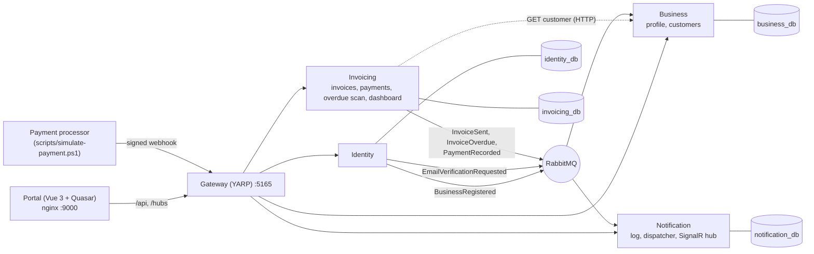

# Invoice Tracker API

[](https://github.com/khutjo/invoice-tracker-api/actions/workflows/ci.yml)

> Backend services and the full-system setup. Frontend: [invoice-tracker-web](https://github.com/khutjo/invoice-tracker-web)

A business invoice tracker. A business registers, adds its customers, creates and sends VAT invoices, and gets paid through a payment processor's webhook. Invoices that go past their due date are picked up automatically, and the customer gets escalating reminders. Every message to a customer is simulated and shown in the portal as it happens.

## Contents

- [Quick start (Docker)](#quick-start-docker)
- [Using the system](#using-the-system)
- [Architecture](#architecture)
- [Overdue detection](#overdue-detection)
- [Payment webhook](#payment-webhook)
- [API surface](#api-surface)
- [Running without Docker](#running-without-docker)
- [Tests and CI](#tests-and-ci)
- [Configuration](#configuration)
- [Decisions and trade-offs](#decisions-and-trade-offs)
- [Future work](#future-work)

## Quick start (Docker)

Needs Docker Desktop with about 4 GB of memory for the containers, and PowerShell 7.

```powershell
git clone https://github.com/khutjo/invoice-tracker-api.git
cd invoice-tracker-api
Copy-Item .env.example .env
```

Fill in `.env`. Choose your own passwords and secrets; this snippet generates the JWT key pair and a webhook secret:

```powershell
$rsa = [System.Security.Cryptography.RSA]::Create(2048)
"JWT_SIGNING_KEY=$([Convert]::ToBase64String($rsa.ExportPkcs8PrivateKey()))"
"JWT_PUBLIC_KEY=$([Convert]::ToBase64String($rsa.ExportSubjectPublicKeyInfo()))"
"PAYMENT_WEBHOOK_SECRET=$([Convert]::ToHexString([System.Security.Cryptography.RandomNumberGenerator]::GetBytes(32)))"
```

Set `MSSQL_SA_PASSWORD`, `APP_DB_PASSWORD` and `RABBITMQ_PASSWORD` to strong passwords (SQL Server needs 8+ characters with upper case, lower case and a digit).

```powershell
docker compose up --build
```

The first build takes a few minutes. Each service applies its own migrations on start.

| URL | What |
| --- | --- |
| http://localhost:9000 | The portal (built from the web repo on GitHub) |
| http://localhost:5165 | API gateway, the only API entry point |
| http://localhost:15672 | RabbitMQ management UI (user `invoice-tracker`, your `RABBITMQ_PASSWORD`) |
| `localhost,1433` | SQL Server, for a database client such as DBeaver (see below) |

**Browsing the databases.** SQL Server is published on port 1433, so any SQL client can look inside. In DBeaver: **New Database Connection → SQL Server**, then:

| Field | Value |
| --- | --- |
| Host / Port | `localhost` / `1433` |
| Authentication | SQL Server Authentication |
| Username / Password | `InvoiceTrackerUser` / your `APP_DB_PASSWORD` (or `sa` / `MSSQL_SA_PASSWORD` for admin) |
| Database | `identity_db`, `business_db`, `invoicing_db` or `notification_db` (or tick **Show all databases**) |
| Driver properties | `trustServerCertificate=true`, because the container uses a self-signed certificate |

Useful tables: `invoicing_db.dbo.invoices`, `invoice_events` (timeline), `payments`, `outbox_messages` (events waiting to be published), and `notification_db.dbo.notifications` (every simulated message with its rendered body).

To build the portal from a local checkout instead, set `WEB_BUILD_CONTEXT=../invoice-tracker-web` in `.env`.

## Using the system

Once the containers are up and healthy, open the portal and register your business. From there, a full cycle takes about five minutes: set up the business, invoice a customer, watch it go overdue and get paid.

1. **Register** at http://localhost:9000. No real email is sent, so find the verification link in the Notification service's log:
   ```powershell
   docker compose logs notification | Select-String "verify your account"
   ```
   Open the link and log in.
2. **Set up the business.** The setup wizard fills in the profile, banking details and payment terms. Registration is eventually consistent (Identity publishes `BusinessRegistered` and Business creates the profile), so the portal shows a short "setting up your business" state first.
3. **Add a customer**, then **create an invoice** with a few lines and **send** it. Pick 0-day terms if you want it due today. An "Invoice sent" notification appears live.
4. **Overdue reminders.** The scan runs every minute with the real date. To see all three stages without waiting, the Owner can run it "as of" a later date through the API:
   ```powershell
   $token = "<access token from the login response or the browser's dev tools>"
   Invoke-RestMethod -Method Post -Headers @{ Authorization = "Bearer $token" } `
     -Uri "http://localhost:5165/api/v1/admin/jobs/overdue-scan?asOf=2026-12-31"
   ```
   The invoice turns Overdue, its timeline shows the reminders, and the reminder notifications arrive. Running the same date again raises nothing new.
5. **Get paid.** Play the payment processor with the included script. It signs the request with `PAYMENT_WEBHOOK_SECRET` from `.env`:
   ```powershell
   .\scripts\simulate-payment.ps1 -InvoiceId <invoice id> -Amount 500 -Replay
   ```
   The first delivery is `processed`, and the replay is answered `duplicate` and records nothing. Pay the rest and the invoice becomes Paid, the dashboard's "paid this month" moves, and the customer gets a receipt.

## Architecture

Four services behind a YARP gateway. Each owns its database and they talk through integration events on RabbitMQ, with one deliberate synchronous call.



```
src/
├─ Gateway/                 YARP routes, ProblemDetails 404 for unknown paths
├─ Services/
│  ├─ Identity/             Api, Infrastructure (ASP.NET Core Identity, tokens)
│  ├─ Business/             Api, Application, Domain, Infrastructure
│  ├─ Invoicing/            Api, Application, Domain, Infrastructure
│  └─ Notification/         Api, Infrastructure
└─ BuildingBlocks/
   ├─ Contracts/            integration event records (versioned), no dependencies
   ├─ Messaging/            RabbitMQ publisher and consumer, transactional outbox
   └─ ServiceDefaults/      JWT validation, roles and policies, health checks, migrate-on-start
tests/                      domain and application unit tests, Identity integration tests
```

**Reliability.** Every publisher writes its events to an `outbox_messages` table in the same transaction as the change that caused them, and a background publisher sends them to RabbitMQ with publisher confirms. Consumers are idempotent: Business on the profile's primary key, and Notification on a unique index of (invoice, notification type, deduplication key). Delivery is at-least-once and processing is effectively once.

**Money and time.** Amounts are `decimal(18,2)` in rand. VAT is calculated and rounded per line with `MidpointRounding.AwayFromZero`, and totals are sums of rounded lines. Due dates are `DateOnly`, and "today" is the business's date in Africa/Johannesburg. All clocks go through `TimeProvider`.

**Concurrency.** Invoices carry a `rowversion`. Reads return `version`, writes send it back, and a stale write answers 409. Invoice numbers come from a per-business, per-year sequence row locked (`UPDLOCK, HOLDLOCK`) inside the send transaction, so numbers are gap-free and never duplicated.

**Database conventions.** Plural snake_case tables, `<singular>_id` keys, and explicit constraint names (`pk_invoices`, `uq_invoices_business_id_invoice_number`, `ix_invoices_business_id_status_due_date`). One EF Core migration history per service.

## Overdue detection

- The rules live in the aggregate. `Invoice.CheckOverdue(today, now)` moves a Sent invoice to Overdue the day after its due date (an invoice due today is not overdue). It returns the reminder stage now due: First at 1 day, Second at 7, Final at 14. The stage reached is stored on the invoice, so each stage is raised once however often the scan runs. If the scanner was down, it jumps straight to the stage due now instead of sending a backlog.
- `OverdueScanner` is a `BackgroundService` on a `PeriodicTimer` (`OverdueScan:Interval`, 1 minute here). Each run queries only invoices that have something due, in batches. Each status change and its `InvoiceOverdue` event are saved together through the outbox. A concurrent payment simply wins (`rowversion`), and the next run looks again.
- Notification turns `InvoiceOverdue` into `OverdueReminder1`, `OverdueReminder2` or `OverdueFinal`. Each message is rendered with the balance, due date and days overdue.
- `POST /api/v1/admin/jobs/overdue-scan[?asOf=yyyy-MM-dd]` runs the scan on demand for the caller's business only (Owner only). `asOf` lets you try later dates without waiting and only works when `OverdueScan:AllowAsOfOverride` is true. Compose turns it on by default (`OVERDUE_SCAN_ALLOW_AS_OF`); turn it off anywhere real.

## Payment webhook

`POST /api/v1/webhooks/payments` is how the payment processor tells us a payment cleared. It has no JWT because the caller is a machine, so every request is signed instead.

```http
POST /api/v1/webhooks/payments
Webhook-Timestamp: 1793700000
Webhook-Signature: v1=<hex HMAC-SHA256 of "{timestamp}.{raw body}" with PaymentWebhook:Secret>
Content-Type: application/json

{
  "eventId": "evt_8f2c...",
  "eventType": "payment.succeeded",
  "invoiceId": "0193...",
  "amount": 500.00,
  "currency": "ZAR",
  "paidAt": "2026-11-03T09:15:00Z",
  "method": "eft",
  "reference": "INV-2026-0001"
}
```

| Answer | When |
| --- | --- |
| 200 `processed` | Payment recorded; the body has the payment id, invoice status and new balance |
| 200 `duplicate` | This `eventId` was already recorded, so nothing changes. The processor stops retrying |
| 200 `ignored` | Not a `payment.succeeded` event |
| 400 | Malformed body, missing fields or a currency other than ZAR |
| 401 | Missing, wrong or expired signature (5-minute window, constant-time compare) |
| 404 | Unknown invoice |
| 409 | The invoice can't take a payment (Draft, already Paid) or changed at the same moment. The processor retries |

- **Idempotent** on the processor's event id, stored in `payments.external_id` with a unique index, so even two simultaneous deliveries record one payment.
- **Matched by `invoiceId`**, which a real integration would attach as metadata when creating the payment link, because invoice numbers are only unique within a business.
- **Overpayment is accepted.** The invoice becomes Paid with a negative balance, which is a credit owed to the customer, and the receipt says so. This is deliberate: a processor reports money that has already moved, and refusing it would only make the processor retry.
- The payment and its `PaymentRecorded` event are saved together through the outbox, and Notification sends a receipt for each payment.

## API surface

Everything goes through the gateway under `/api/v1`. Errors are RFC 9457 ProblemDetails, and enums travel as names. In Development each service serves its OpenAPI document at `/openapi/v1.json` and a Scalar UI at `/scalar`. Each API project has a `.http` file with ready-made requests.

| Method | Path | Service | Who |
| --- | --- | --- | --- |
| POST | `/auth/register`, `/auth/verify-email`, `/auth/login`, `/auth/refresh`, `/auth/logout` | Identity | Anonymous |
| GET, PUT | `/business`, `/business/settings`, `/business/logo` | Business | Any user reads, Owner writes |
| GET | `/business/lookups`, `/business/lookups/postal-codes/{code}` | Business | Any user |
| GET, POST | `/customers` (paged search) | Business | Any user |
| GET, PUT, DELETE | `/customers/{id}` (DELETE archives) | Business | Any user |
| GET, POST | `/invoices` (filters: status, customerId, issuedFrom, issuedTo, overdueOnly, search) | Invoicing | Any user |
| GET, PUT, DELETE | `/invoices/{id}` (PUT and DELETE drafts only) | Invoicing | Any user |
| POST | `/invoices/{id}/send` | Invoicing | Any user |
| GET | `/dashboard` | Invoicing | Any user |
| POST | `/admin/jobs/overdue-scan` | Invoicing | Owner |
| POST | `/webhooks/payments` | Invoicing | Payment processor (HMAC) |
| GET | `/notifications` (filters: type, status, invoiceId, search) | Notification | Any user |
| WS | `/hubs/notifications` (SignalR, `notificationSent`) | Notification | Any user |

Every service also exposes `/health/live` and `/health/ready`, where ready means its database answers.

## Running without Docker

Needs the .NET 10 SDK, Docker for SQL Server and RabbitMQ, and the `dotnet-ef` tool.

```powershell
docker compose up -d sqlserver sqlserver-init rabbitmq
.\scripts\db-setup.ps1                       # connection strings into user-secrets, applies migrations

# Identity's signing key, then copy its public half to every other service
dotnet user-secrets set "Jwt:SigningKey" "<base64 PKCS#8>" --project src/Services/Identity/InvoiceTracker.Identity.Api
dotnet run helpers/set-jwt-public-key.cs

dotnet user-secrets set "RabbitMq:Password" "<RABBITMQ_PASSWORD>" --project src/Services/<Service>/InvoiceTracker.<Service>.Api   # each service
dotnet user-secrets set "PaymentWebhook:Secret" "<32+ characters>" --project src/Services/Invoicing/InvoiceTracker.Invoicing.Api
```

Then run the gateway (5165) and the four APIs from Rider, or with `dotnet run --project`. Identity listens on 5067, Business on 5224, Invoicing on 5073 and Notification on 5149. The web repo's dev server proxies `/api` and `/hubs` to the gateway.

## Tests and CI

```powershell
dotnet test
```

| Suite | Covers |
| --- | --- |
| `Invoicing.Domain.Tests` | Totals and per-line VAT rounding (0.005 rounds up), draft editing rules, send, numbering, overdue detection (due today is not overdue, one reminder per stage, escalation at 7 and 14 days, a missed run jumps to the right stage), payments (partial, exact, over, refused on Draft and Paid) |
| `Invoicing.Application.Tests` | Webhook signature: valid, tampered body, wrong secret, expired timestamp, malformed headers |
| `Business.Domain.Tests` | Business profile and customer rules |
| `Identity.IntegrationTests` | Register, verify, login (uniform failures, lockout after five attempts), refresh rotation and reuse detection, logout, against real SQL Server through Testcontainers |

GitHub Actions runs `dotnet format --verify-no-changes`, a Release build with warnings as errors, and every test with coverage collected (reported, not gated). The web repo has its own pipeline: lint, type-check, Vitest and build.

## Configuration

Non-secret settings live in `appsettings.json`. Secrets come from user-secrets locally and from `.env` in Docker, and none are committed.

| Setting | Where | Notes |
| --- | --- | --- |
| `ConnectionStrings:<Service>Db` | each service | One database per service on one SQL Server, through an app login with `dbcreator` |
| `Jwt:SigningKey` | Identity | RSA private key, base64 PKCS#8 (`JWT_SIGNING_KEY`) |
| `Jwt:PublicKey` | every other service | Its public half, base64 SubjectPublicKeyInfo (`JWT_PUBLIC_KEY`) |
| `RabbitMq:*` | every service | Host, user and password (`RABBITMQ_PASSWORD`) |
| `PaymentWebhook:Secret`, `PaymentWebhook:Tolerance` | Invoicing | Shared HMAC secret (`PAYMENT_WEBHOOK_SECRET`), 5-minute replay window |
| `OverdueScan:Interval`, `BatchSize`, `AllowAsOfOverride` | Invoicing | 1 minute, 100, and the "as of" date switch |
| `Services:Business:BaseUrl` | Invoicing | Customer lookups |
| `Portal:BaseUrl` | Notification, Gateway | Where verification links point (`PORTAL_BASE_URL`) |
| `Database:MigrateOnStartup` | every service | True in compose |

## Decisions and trade-offs

- **The JWT public key comes from config, not JWKS.** Each service validates tokens locally with Identity's RSA public key. That keeps the services independent of Identity being up. The cost is that rotating the key means redeploying the key everywhere; a JWKS endpoint is future work.
- **No Key Vault.** user-secrets and `.env` are enough for this scope. In Azure the same keys would come from Key Vault through configuration.
- **Single-instance background jobs.** The outbox publisher, the notification dispatcher and the overdue scanner each assume one instance per service and use plain queries without lock hints. Scaling out would add a distributed lock or row claiming (`UPDLOCK, READPAST`).
- **Invoicing calls Business for customer details** (typed `HttpClient` with standard resilience) instead of keeping customer snapshots from events. It's simpler, and the details are frozen onto the invoice at send, so history never changes. The cost is runtime coupling: creating or sending an invoice needs Business up, and answers 503 otherwise.
- **Tenant isolation is explicit, not a global query filter.** Every query filters on the token's `business_id`, and another tenant's ids answer 404. This is visible in each query rather than hidden in the model.
- **No inbox table.** Consumers are idempotent on natural keys instead (profile primary key, notification unique index), which is enough for the events here.
- **Overpayments are accepted** and shown as a credit (see [Payment webhook](#payment-webhook)).
- **Refresh tokens travel in the JSON body** and are stored by the SPA, not in an httpOnly cookie. They are hashed at rest, rotated on every use, and the whole family is revoked on reuse. A cookie would be stronger against XSS and is future work.
- **Email verification is required before login**, and the "email" is simulated: the verification link is logged by Notification.
- **The Overdue status is stored, not computed.** The scanner writes it, so the timeline records when it happened. The invoice list's "overdue only" filter and the dashboard also count Sent invoices that are past due but not yet scanned, so the two never disagree.

## Future work

Kept out of scope to deliver a complete, tested core on time:

- PDF tax invoices (QuestPDF), file store (Azure Blob / Azurite) and a CDN for logos and documents
- Cancelling an invoice with a reason, plus refunds and applying overpayment credit to another invoice
- Integration tests for Business, Invoicing and Notification (including a cross-tenant 404 test and an end-to-end Playwright run)
- Rate limiting on `/auth/*` at the gateway, security headers on nginx, and HTTPS/HSTS outside Development
- Structured logging (Serilog), OpenTelemetry traces across services and RabbitMQ, and the Aspire dashboard
- A "Run overdue check" action in the portal for the Owner, so the on-demand scan doesn't need the API call
- Owner invites for Accountant users, a JWKS endpoint and key rotation, real email and SMS senders
- Per-business time zones in Invoicing (stored in Business today, Africa/Johannesburg assumed)

## Notes

- **Memory:** SQL Server needs about 2 GB; give Docker about 4 GB in total.

## Licence

MIT, see [LICENSE](LICENSE).
